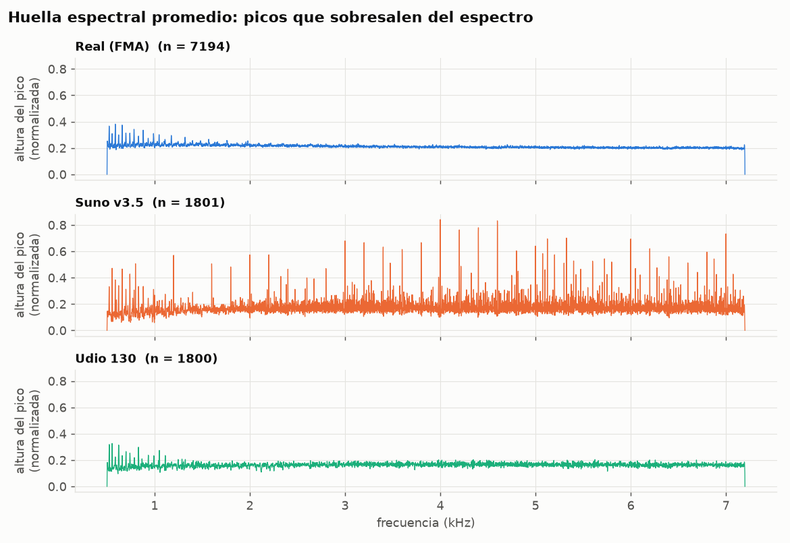
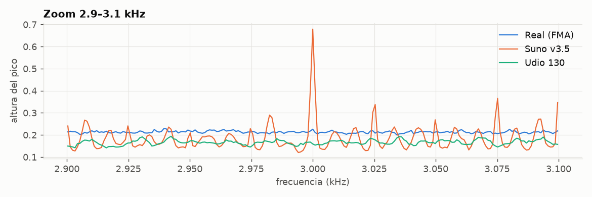
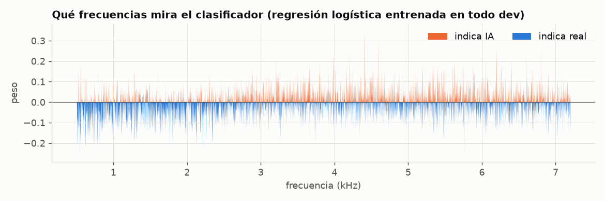
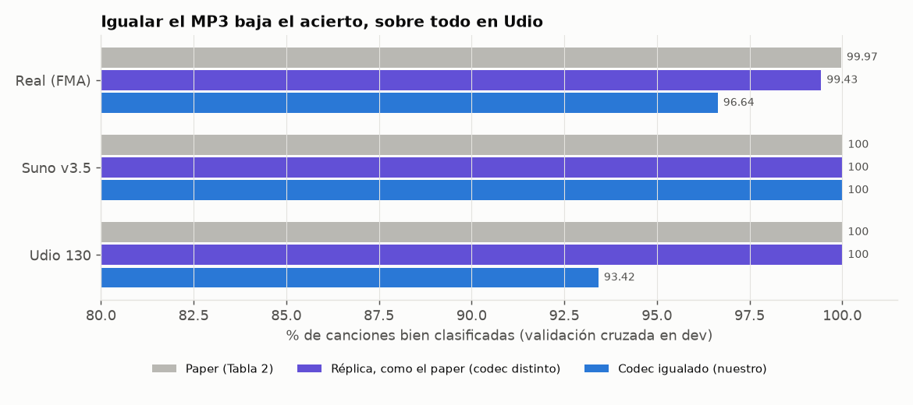
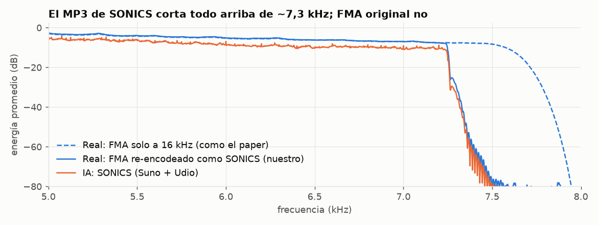
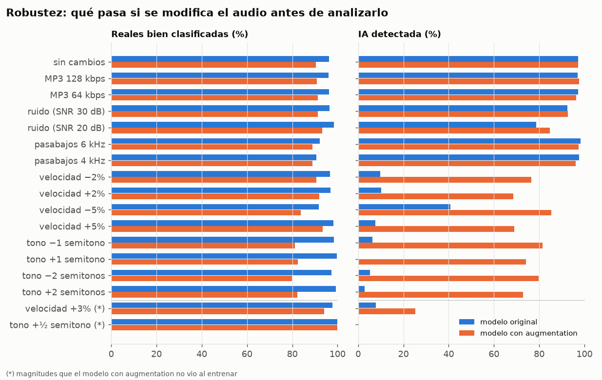
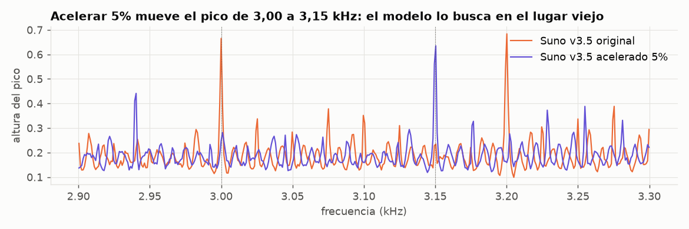
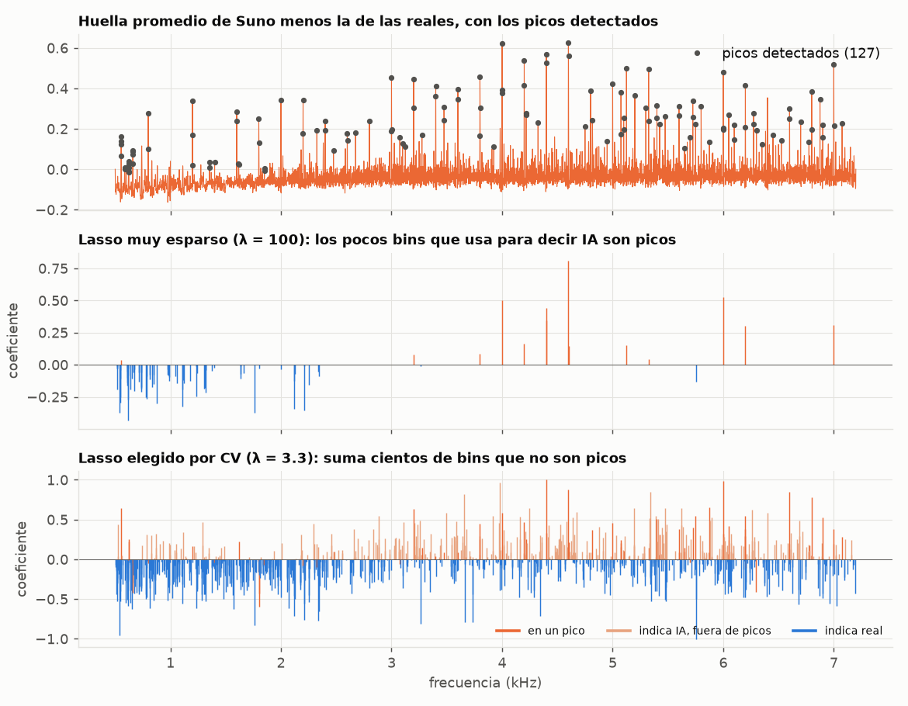
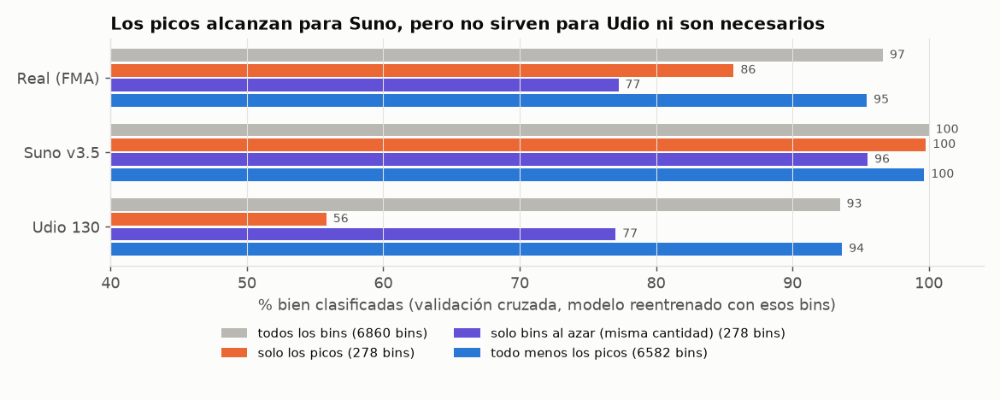

# Resultados (dev)

> Todo sale **solo de dev**. Los porcentajes son de validación cruzada: se entrena con el 80% de las canciones y se mide sobre el 20% restante, cinco veces. El heldout todavía no se evaluó.

**Datos:** 7.194 canciones reales (FMA), 1.801 de Suno v3.5 y 1.800 de Udio 130. Todas a 16 kHz mono, en el mismo formato MP3 y recortadas a 29 s.

**Métrica principal: *balanced accuracy*.** Es el promedio entre el % de reales bien clasificadas y el % de canciones de IA detectadas. Se usa porque hay el doble de reales que de IA, y con la accuracy común un modelo que acierte mucho en reales parecería mejor de lo que es. Para comparar con el paper, que en su Tabla 2 reporta el acierto por clase, también se muestra el acierto de cada clase.

## Resumen

| | Paper | Nosotros |
|---|---|---|
| Huella de Suno: picos finos en lugares fijos | ✔ | ✔ |
| Huella de Udio: más difusa | ✔ | ✔ (casi sin picos visibles) |
| Detector simple (regresión logística) con ~100% de acierto | ✔ | ✔ **solo si el MP3 de reales e IA es distinto** |
| Con el mismo MP3 en las dos clases | no se probó | **96,7% de balanced accuracy** (Udio baja a 93%) |
| Cambiar el tono o la velocidad rompe el detector | lo anticipan, sin probarlo | ✔ la detección de IA cae a 0–10% |
| El modelo usa los picos | lo suponen (pesos positivos en los picos) | ✔ para Suno; Udio se detecta por otra información, más difusa (§6) |

## 1. La huella: Suno deja picos finos y regulares; Udio casi no

- **Suno v3.5** muestra decenas de picos angostos siempre en los mismos lugares, muchos en múltiplos de 200 Hz (3,0 / 4,0 / 4,4 / 4,6 kHz…). Es lo que predice el paper: el generador "copia" energía a frecuencias que dependen de cómo está construido, no de la canción.
- **Udio 130** casi no tiene picos entre 0,5 y 7,2 kHz. El paper también describe su huella como "más difusa".
- **Las reales** son planas.
- **El pico en ~7,25 kHz aparece en las tres clases:** es el borde del filtro del MP3, no un artefacto de la IA (ver §3).

Visto de cerca, cada pico de Suno ocupa 1 o 2 Hz: son líneas, no bultos. El clasificador aprende justamente a buscar esas líneas (pesos naranjas):

## 2. El detector funciona, pero menos de lo que dice el paper

- **Haciéndolo como el paper** (reales y fakes con MP3 distinto, banda de 1–8 kHz) reproducimos la Tabla 2: 99,4% en reales y 100% en Suno y Udio.
- **Con el mismo MP3 para las dos clases**, la balanced accuracy baja de 99,7% a **96,7%**. Suno sigue en 100%; **Udio cae a 93%**, y aparecen más reales confundidas con IA (3,4%).

| Modelo (codec igualado) | Reales | Suno v3.5 | Udio 130 | Balanced accuracy |
|---|---|---|---|---|
| Regresión logística (como el paper) | 96,6 | 100 | 93,4 | **96,7** |
| SVM lineal | 95,8 | 99,3 | 86,4 | 94,4 |
| SVM no lineal (RBF) | 97,3 | 99,4 | 96,2 | **97,6** |

Un modelo más flexible (SVM RBF) mejora un punto, sobre todo en Udio, pero no cambia la conclusión.

**Por qué la banda de 0,5–7,2 kHz.** El clasificador solo recibe la huella dentro de esa banda (~6.700 valores, uno por Hz):

- **Techo en 7,2 kHz:** arriba de eso no hay información de la IA, solo el borde del corte del MP3 (ver §3). Si se incluye, el modelo lo usa como atajo.
- **Piso en 0,5 kHz:** en los graves domina la música misma (bajos, notas), que cambia de canción en canción. Elegido por validación cruzada:

| Piso de la banda | 0,5 kHz | 1 kHz (paper) | 2 kHz | 5 kHz (código de Deezer) |
|---|---|---|---|---|
| Balanced accuracy | **95,7** | 94,6 | 92,3 | 83,5 |
| Udio detectado | 89,6 | 86,5 | 80,7 | 64,1 |

(Todas con techo en 7,2 kHz y C = 1.) Subir el piso perjudica sobre todo a Udio, cuya huella parece estar en frecuencias más bajas. No se probó bajar de 0,5 kHz.

**C de la regresión logística.** C controla cuánto se le permite al modelo ajustarse a los datos de entrenamiento: más chico = modelo más simple. Se probaron C = 0,001 / 0,003 / 0,01 / 0,03 / 0,1 / 1 / 10, y por validación cruzada se eligió **C = 0,03**.

## 3. El atajo del MP3

Las canciones de SONICS vienen en un MP3 muy comprimido, que borra todo por encima de ~7,3 kHz. Las reales de FMA no tienen ese corte. Si no se igualan, el clasificador puede usar ese borde como atajo.

**Qué se hizo.** Para cada celda de la tabla se entrena **una regresión logística nueva** y se mide su balanced accuracy con la misma validación cruzada (mismos folds, C = 0,03). Lo único que cambia entre celdas es qué dos grupos de canciones se le pide separar (filas) y qué banda de la huella recibe (columnas). La pregunta de cada celda es: ¿se puede aprender a separar estos dos grupos mirando solo la huella? Para cada celda hacemos un k-fold cv

| Grupos que el modelo aprende a separar | Banda 1–8 kHz (paper) | Banda 0,5–7,2 kHz (nuestra) |
|---|---|---|
| **Control:** FMA original vs la misma FMA re-comprimida como SONICS (todas reales; solo cambia el MP3) | **98,7%** → detecta el MP3 | 53% → azar |
| IA vs reales, cada una con su MP3 (como el paper) | 99,7% | 96,9% |
| IA vs reales, las dos con el mismo MP3 (nuestro pipeline) | 96,7% | 96,7% |

En el control no hay IA. Si el modelo logra separar esos grupos, la huella está midiendo el MP3. *(El 98,7% sale de una primera corrida con C = 0,01.)*

**Conclusión:** los ~3 puntos de balanced accuracy que separan nuestro 96,7% del ~100% del paper vienen del borde del MP3, no de la IA. Alcanza con una de dos cosas para eliminar el atajo: igualar el MP3 o cortar la banda antes de 7,2 kHz.

## 4. Robustez: cambiar el tono o la velocidad lo rompe

Se modificó el audio del 20% de evaluación (2.159 canciones) y se volvió a clasificar con el modelo entrenado en el 80% restante, sin modificar.

- **Recomprimir en MP3 o filtrar agudos (pasabajos) casi no afecta la detección de IA** (97–98%, igual que sin cambios). Con pasabajos baja un poco el acierto en reales (96% → ~91%).
- **Ruido fuerte (SNR 20 dB):** la detección baja a 79%, y Udio a 68%.
- **Cambiar la velocidad ±2% o el tono ±1 semitono:** la detección de IA cae a **0–10%**. Casi todas las canciones de IA pasan como reales. El paper lo anticipaba sin probarlo.

Resumido en balanced accuracy (50% = azar). Cuando hay varias magnitudes, se muestra el promedio:

| Cambio en el audio | Modelo original | Con augmentation (§5) |
|---|---|---|
| Sin cambios | 96,8 | 93,8 |
| MP3 (128 / 64 kbps) | 96,6 | 94,0 |
| Pasabajos (6 / 4 kHz) | 94,7 | 92,8 |
| Ruido, SNR 30 dB | 94,4 | 92,0 |
| Ruido, SNR 20 dB | 88,5 | 89,0 |
| Velocidad ±2 / ±5% | **56,5** | 82,4 |
| Tono ±1 / ±2 semitonos | **51,1** | 79,2 |
| Velocidad +3% (no vista en el augmentation) | 52,8 | **59,7** |
| Tono +½ semitono (no visto en el augmentation) | 50,0 | **49,9** |

El motivo se ve en el gráfico: los picos siguen ahí, pero corridos, y el modelo los busca en el lugar viejo.

## 5. Entrenar con audio modificado (augmentation) no lo arregla

Se reentrenó sumando una copia modificada de cada canción de entrenamiento (barras naranjas en la figura de §4):

- **Con los mismos cambios que vio al entrenar,** la detección sube a 69–85%, pero se equivoca más con las reales (96% → 90%). En balanced accuracy, pasa de ~51–57% a ~79–82%, a cambio de perder 3 puntos sin cambios (96,8 → 93,8).
- **Con cambios que no vio,** vuelve a fallar: +½ semitono → **0%** de IA detectada; +3% de velocidad → 25%. La balanced accuracy queda en 50–60%, casi azar.

El modelo no aprende "hay picos, estén donde estén": memoriza algunas posiciones más. Hacerlo robusto requeriría otro tipo de feature, por ejemplo una que mida si hay picos regulares sin importar dónde caen (objetivo 4 del README).

## 6. ¿El modelo usa los picos que vemos?

**Qué se hizo.** Primero se marcan "los picos" sin mirar el modelo: son las frecuencias donde la huella promedio de un generador sobresale de la de las reales (127 bins para Suno, 84% en múltiplos de 25 Hz; solo 5 para Udio). Ensanchados ±1 bin, ocupan el **4%** de la banda. Después, con validación cruzada (picos calculados solo con los datos de entrenamiento de cada fold):

1. **Concentración:** qué parte del peso que empuja a "IA" cae en ese 4%.
2. **Ablación:** a las canciones de evaluación se les pisan los bins de pico con los de una canción real al azar, y se mide cuánto cae la detección. Control: pisar la misma cantidad de bins al azar.
3. **Reentrenar** solo con los picos, solo con bins al azar (misma cantidad) y con todo menos los picos.
4. **Lasso:** regresión logística que se obliga a usar pocos bins (más λ = menos bins). Se barrió λ y se eligió por validación cruzada.

| Lasso: λ | Bins que usa para decir "IA" | % de esos bins que son picos | Suno detectado | Udio detectado | Balanced accuracy |
|---|---|---|---|---|---|
| 100 | 14 | **100%** | 100 | 31 | 79,2 |
| 33 | 29 | **86%** | 100 | 80 | 90,9 |
| 10 | 191 | 25% | 100 | 89 | 94,4 |
| **3,3 (elegido por CV)** | 436 | 12% | 100 | 90 | **95,2** |
| 1 | 661 | 10% | 100 | 89 | 95,1 |

*(Se barrió λ = 333 / 100 / 33 / 10 / 3,3 / 1 / 0,3 / 0,1; los extremos rinden peor.)*

- **Cuando el Lasso puede usar muy pocos bins, elige exactamente los picos.** Con λ = 100, los 14 bins que usa para decir "IA" son todos picos de Suno (3,2 / 4,0 / 4,4 / 4,6 kHz…), cuando los picos son solo el 4% de la banda. Con eso detecta el 100% de Suno, pero casi nada de Udio.
- **Para detectar Udio necesita cientos de bins más, casi ninguno en un pico.** El Lasso elegido usa 436 bins "IA", de los cuales solo el 12% son picos, aunque concentran el 21% de su peso (5 veces más que el azar). En la regresión logística normal, los picos tienen el 12% del peso (3 veces más que el azar).

| Ablación (modelo ya entrenado) | Reales | Suno | Udio | Balanced accuracy |
|---|---|---|---|---|
| Sin tocar | 96,6 | 100 | 93,5 | 96,7 |
| Picos pisados | 93,2 | **90,8** | 94,2 | **92,8** |
| Misma cantidad de bins al azar pisados | 97,4 | 99,9 | 90,1 | 96,2 |

**Conclusión:**
- **Para Suno, el modelo sí usa los picos.** Pisarlos le hace perder ~9 puntos en Suno, y pisar bins al azar no le hace nada. Con solo los picos detecta el 99,8% de Suno.
- **Pero no son indispensables.** Sin los picos, el modelo reentrenado llega casi a lo mismo (96,1% contra 96,7%). Incluso 278 bins al azar detectan el 96% de Suno: su huella difiere de la real en toda la banda, no solo en los picos marcados.
- **Udio no se detecta por picos** (con solo los picos: 56%, casi azar), sino por información repartida en muchas frecuencias.

Esto coincide con el paper, que muestra pesos positivos en los picos de Suno y dice que Udio es "más difuso". Lo que el paper no muestra es que, para Udio, el detector depende de algo distinto de los picos.

## Pendiente

- **Heldout** (`scripts/07_heldout.py`, espera autorización): confirmar las cifras en canciones nuevas y medir la generalización a generadores no vistos (Suno v2, Suno v3 y Udio 32; en el paper Udio 32 falla, con 40%).
